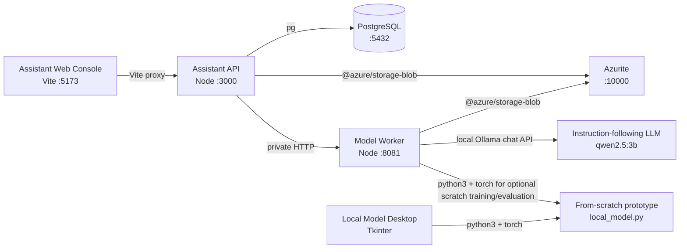

# Azure Debug Plan

> This plan is the source of truth for generating the
> VS Code debug setup in this workspace.
>
> **Status:** Generated; dependency verification complete
> **Execution Mode:** Guided
> **Created:** 2026-10-23T09:26:44-05:00
> **Last Updated:** 2026-10-23
>
> <!-- Guided Mode (default) - review and approve before generating debug artifacts. -->

---

## Prerequisites

| Tool / Extension | Category | Service(s) | Installed | Version |
|------------------|----------|------------|-----------|---------|
| Node.js | Runtime | assistant-web, assistant-api, model-worker | ✅ | 22.23.4 |
| npm | Package manager | assistant-web, assistant-api, model-worker | ✅ | 10.9.9 |
| Vitest | Test runner | assistant-web, assistant-api, model-worker | ✅ | 3.2.7 |
| Python | Runtime | local-model, model-worker | ✅ | 3.14.4 (`.venv/bin/python`) |
| pip | Package manager | local-model, model-worker | ✅ | 26.2.2 (`.venv`) |
| PyTorch (`torch`) | Model dependency | local-model, model-worker | ✅ | 2.14.1+cpu (`.venv`) |
| Docker | Container runtime | assistant-api, model-worker | ❓ | CLI 29.9.2; daemon access denied |
| Docker Compose | Compose provider | assistant-api, model-worker | ✅ | 5.6.1 |
| Chrome | Browser | assistant-web | ✅ | 156.0.8078.47 |
| VS Code JavaScript Debugger (`ms-vscode.js-debug`) | VS Code debug integration | assistant-web, assistant-api, model-worker | ❓ | Not found in user extension directories |
| VS Code Containers (`ms-azuretools.vscode-containers`) | VS Code debug integration | assistant-api, model-worker | ✅ | 2.5.3 |
| VS Code Python (`ms-python.python`) | VS Code debug integration | local-model, model-worker | ✅ | 2026.10.0 |
| VS Code Python Debugger (`ms-python.debugpy`) | VS Code debug integration | local-model, model-worker | ✅ | 2026.6.0 |

> ✅ Docker engine access was restored for the execution step; PostgreSQL and Azurite are running and healthy. The ignored local `.env` was created from `.env.example`. The worker debug configuration prepends `.venv/bin` to `PATH`, and the desktop configuration selects `.venv/bin/python3`. This shell did not expose `node` or `npm`, so Node build/migration execution could not be run here; VS Code must provide the Node runtime for the JavaScript configurations.

---

## Debug Configurations

Each checked service will receive a VS Code debug configuration in `.vscode/launch.json`.

| Generate | Debug Config Name | Service Label | Service Root | Project Type | Runtime | Version | Azure Dependencies |
|----------|--------------------|---------------|--------------|--------------|---------|---------|---------------------|
| [x] | Local Model Desktop (debug) | Local Model Desktop Prototype | . | desktop-app | python | 3.14.4 | — |
| [x] | Assistant API (debug) | Assistant and Systems Management API | ./services/assistant-api | container-app | node-ts | Node 22.23.4 | PostgreSQL, Azure Storage, Azure Key Vault (development stub) |
| [x] | Model Worker (debug) | Independent Model Training and Inference Worker | ./services/model-worker | container-app | node-ts | Node 22.23.4; Python bridge 3.14.4 | Azure Storage |
| [x] | Assistant Web (debug) | Assistant Web Console | ./services/assistant-web | frontend-spa | node-ts | 22.23.4 | — |
| [x] | Debug All Services | Debug All Services |  | *Compound Config* | * |  |  |

Project Type Descriptions

| Project Type | Description |
|-------------|-------------|
| desktop-app | Standalone Python desktop application using Tkinter. |
| container-app | Application with a Dockerfile, debugged with its local development entry point. |
| frontend-spa | Browser-based single-page application served by Vite. |

> ℹ️ **Proxy detected:** Assistant Web proxies `/api` and `/openapi.json` to Assistant API at `http://localhost:3000` via `services/assistant-web/vite.config.ts`. The compound configuration should start the API and worker before the web frontend, after local dependencies are ready.

The existing `.vscode/settings.json` and `docker-compose.yml` are preserved. Local Key Vault access uses the API's development stub and does not require an emulator.

## Generated Artifacts

The selected debug configurations are in `.vscode/launch.json`, supporting tasks are in `.vscode/tasks.json`, root convenience scripts are in `package.json`, and smoke-request collections are in `.azure/assistant-api.http` and `.azure/model-worker.http`. The local `.env` is ignored by `.gitignore`.

---

## Orchestrator

| Orchestrator | Container Runtime | Compose Command | Description |
|-------------|-------------------|-----------------|-------------|
| Docker Compose | Docker (❓ engine access) | `docker compose` | Docker CLI 29.9.2 and Compose 5.6.1 are present, but daemon access is denied. Uses the existing Compose file to start only PostgreSQL and Azurite as local dependencies; keep their named volumes between runs. |

---

## Emulators

| Dependent Service | Emulator | Purpose |
|-------------------|----------|---------|
| PostgreSQL | PostgreSQL Container | Relational database for API persistence and Knex migrations. |
| Azure Storage | Azurite 3.37.0 (`--skipApiVersionCheck`) | Local Blob Storage for worker checkpoints and approved data. The installed SDK sends API version `2026-10-06`; Azurite 3.37.0 supports through `2026-06-06`, so version-header validation is skipped for this local emulator. |

---

## Architecture Diagram

During local debugging, Vite proxies browser API requests to the Node API; the API uses PostgreSQL, Azurite, and the private worker, while the worker invokes the existing Python/PyTorch model bridge. The desktop prototype runs independently.

---

## Migrations

When selected, the generation phase creates an automated VS Code migration task that applies the existing schema before API debugging.

| Generate | Service | Migration Tool |
|----------|---------|---------------|
| [x] | Assistant and Systems Management API | Knex (`npm run migrate --workspace=services/assistant-api`) |

---

## API Test Collections

When selected, the generation phase creates runnable smoke-test collections for the locally started HTTP services.

| Generate | Service | Description |
|----------|---------|-------------|
| [x] | Assistant and Systems Management API | 

HTTP Endpoints (23)
 GET /api/health POST /api/auth/register POST /api/auth/login GET /api/auth/me POST /api/auth/logout GET /openapi.json GET /api/conversations POST /api/conversations GET /api/conversations/{conversation_id}/messages POST /api/conversations/{conversation_id}/messages GET /api/systems GET /api/systems/events GET /api/systems/{system_id}/diagnostics POST /api/systems/{system_id}/diagnostics/{diagnostic_id} GET /api/terminal/activity GET /api/operations/proposals POST /api/operations/proposals POST /api/operations/proposals/{proposal_id}/decision GET /api/models/training-runs POST /api/models/training-runs GET /api/models/checkpoints GET /api/models/evaluations POST /api/models/evaluations 
 |
| [x] | Independent Model Training and Inference Worker | 

HTTP Endpoints (6)
 GET /health POST /internal/v1/inference POST /internal/v1/training-runs GET /internal/v1/training-runs/{run_id} POST /internal/v1/evaluations GET /internal/v1/evaluations/{evaluation_id} 
 |

---

## Convenience Scripts

| Generate | Script | Registered In | Description |
|----------|--------|---------------|-------------|
| [x] | local-dependencies:start | ./package.json | Start only PostgreSQL and Azurite from the existing Compose file. |
| [x] | local-dependencies:stop | ./package.json | Stop PostgreSQL and Azurite while preserving their data volumes. |
| [x] | db:migrate | ./package.json | Apply pending API schema migrations to the local PostgreSQL database. |
